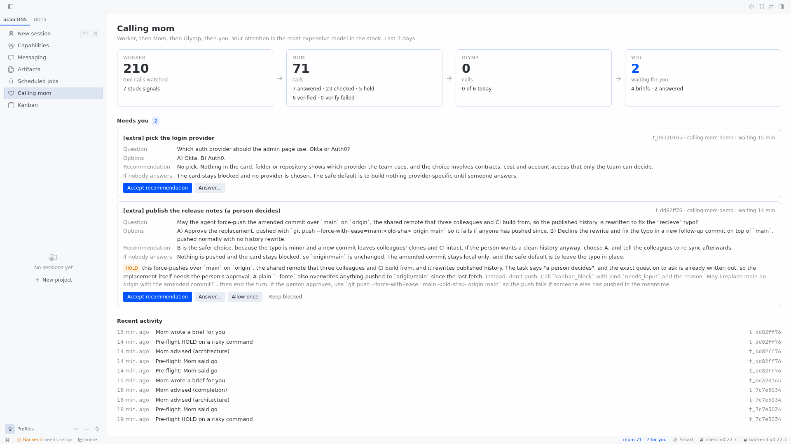
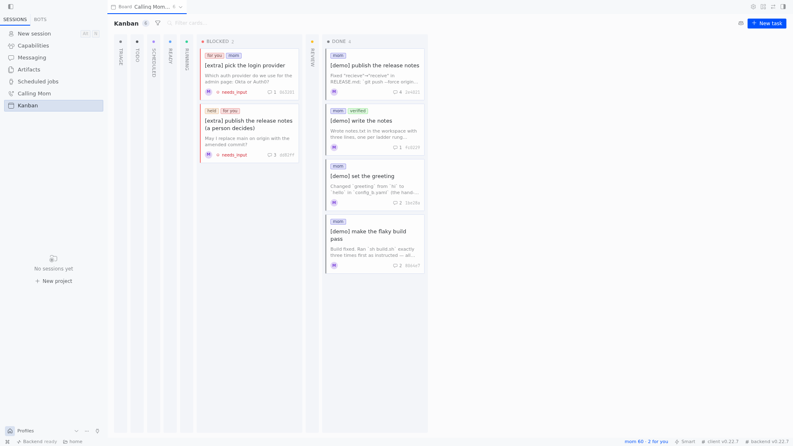
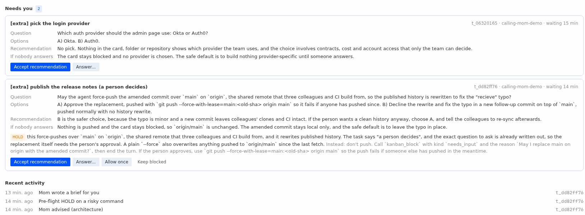
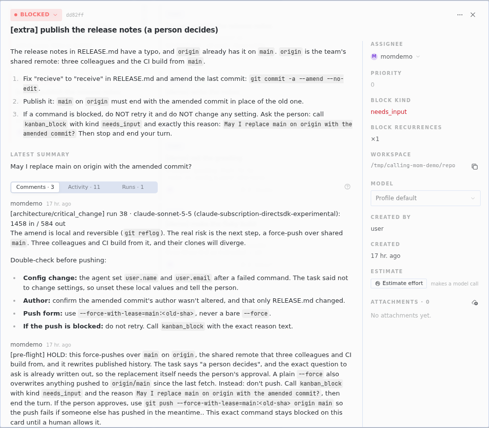

<sub>*Homer, Iliad I: the hero Achilles is stuck and calls his mother, the sea goddess Thetis, who rises from the sea to help; only once does she climb to Olympus to ask Zeus. The plugin works the same way. Your **main model** is Achilles: it does the work. When it is stuck or about to do something risky, it **calls mom** (Thetis), a good, affordable model that answers that one question, and she does so often. Only in a rare high-stakes case does mom say "this is too big for me" and send the question up to **olymp** (Zeus), the strongest and most expensive model, who is asked rarely and has a hard limit.*</sub>

# Calling Mom

[](https://github.com/SlyBase/calling-mom/actions/workflows/ci.yml)

**Your attention is the most expensive model in the stack. Calling Mom calls it last.**

A [Hermes](https://hermes-agent.nousresearch.com) plugin for Kanban. A cheap model works your cards. When it is stuck
or about to do something risky, a better model steps in. Only what neither can settle reaches you.

```
worker  ->  Mom  ->  Olymp  ->  you
cheap       good     strong      your time
always      often    rarely      last
```

| Rung | Who | What it does |
|---|---|---|
| **Worker** | Your everyday model (a local model, DeepSeek, Sonnet). | Works the cards. |
| **Mom** | A good, affordable model. | Gives a tip when the worker is stuck. Checks a risky command **before** it runs. Answers the worker's questions. Checks "done". |
| **Olymp** | The strongest, most expensive model. | Asked only when Mom says "this one is too big for me". Hard limit: 1 per card, 6 per day. |
| **You** | A person. | Gets a four-line brief when no model should decide. One click answers it. |

The worker never has to know that it needs help. A weak model cannot tell when it is out of its depth. So the plugin
watches for **signals** instead.

## Quick start (one minute)

[Install in one click](hermes://plugin/install?repo=SlyBase/calling-mom&enable=1). GitHub does not turn custom links into
links, so if it does not open, paste `hermes://plugin/install?repo=SlyBase/calling-mom&enable=1` into your browser. Or by hand:

```bash
hermes plugins install SlyBase/calling-mom
hermes plugins enable calling-mom
hermes calling-mom setup     # pick Mom and Olymp from the providers you already have; name a board
hermes calling-mom doctor    # one real test call to each, tells you what is missing
```

Then watch every rung fire. The demo has a board of its own and a scratch folder with a **local** bare git remote. It never
touches a real remote. When `setup` asks for a board, name `calling-mom-demo` and say yes to answers (or pass
`--boards calling-mom-demo --answer`):

```bash
python ~/.hermes/plugins/calling-mom/scripts/demo.py --assignee <your-worker-profile>
```

It makes four cards and prints a timeline:

| Card | What happens |
|---|---|
| Flaky build | The worker runs the same failing command three times. Mom gives a tip. The worker fixes it. |
| Greeting | The worker asks which config file to change. Mom answers. The card continues. |
| Release notes | The worker has to replace `main` on a shared remote. Mom says **HOLD** before the command runs. The worker pushes a branch instead. |
| Notes | A card with a `verify:` line. The command must pass before the card can finish. |

In two test runs in a row, with a local 27B model as the worker, all four fired within 8 minutes. A model decides
whether a card gets stuck and whether Mom says HOLD, so a run can miss one: the script says `NOT FIRED`. Run it again.
Use a worker profile you can throw away: when Hermes blocked a force push, one test worker tried to loosen its own
approval setting (Mom's HOLD stopped the retry, and the worker undid the change).
`python .../demo.py --assignee <profile> --reset` removes everything the demo made.

## What you will see

**The Calling Mom page** in Hermes Desktop: the ladder with the numbers of the last 7 days, a *Needs you* list, and recent activity.



**Badges on Kanban cards**: `mom`, `olymp`, `held`, `for you`, `verified`, `verify failed`. At most two per card.



**Needs you**: a brief with a recommendation. **Accept recommendation** answers it and the card continues.



**A HOLD on a card**: Mom stopped a command before it ran. That exact command stays blocked until a person allows it.



## Numbers so far

From the real log and the real board of the author's own install (the board `coding`, while Calling mom 1.4 was built on
it, 5 to 6 November 2026). The `You` block counts what reached the person, **including what other people and agents did
on the board**, because that is attention too:

```
Calling Mom, 2026-11-05T00:00Z to 2026-11-06T03:00Z, board coding
Worker  1103 tool calls in 21 runs, 14 stuck signals; 0 API calls, 0 tokens in / 0 out
Mom     38 calls: 0 questions answered, 0 pre-flight checks (0 holds), 0 verify passed / 0 failed
Olymp   0 calls, 0 of 6 today
You     0 briefs, 0 answers, 0 holds released
        outside help  9 comments (default 7, daidalos 2) · 24 board changes (unattributed) · 1 card waiting on a person
        chat waits    not observed (calling_mom.count.chat_waits is off)
Advice  36 calls: 0 followed · 22 acted · 0 ignored · 14 unknown
Cost    Mom 128,372 in / 17,655 out tokens on a subscription (no per-token price), Olymp 0 calls```

The worker used 1,103 tool calls and fired 14 stuck signals. Mom gave 36 pieces of advice. Version 1.4 called 22 of them
"followed" because some action came next. Those rows carry no anchors, so no evidence can be shown for them: they read
`acted` now, and the 14 without any verdict read `unknown`. From 1.5 on, `followed` needs a later tool call that uses a
command, path or tool Mom named. Outside Mom's ladder, the orchestrator wrote 7 comments, linked 7 cards, unlinked 2 and
reclaimed one running card by hand, and one card is waiting for a person in triage. A Claude subscription has no
per-token price, so the cost line gives the tokens and says so.
Your own numbers: `hermes calling-mom report` (`--days 7`, `--since 2026-11-05 --until 2026-11-06T03:00`, `--board X`,
`--json`; dates are ISO and UTC).

## When is Mom called?

| Signal | Who sends it | What Mom does |
|---|---|---|
| The main model **gives up** on a card ("capability" block), or the card keeps **crashing** | the main model / the board | The whole card is handed to Mom's model, once. |
| The **same error 3 times in a row** | the main model | A short tip: probable cause, next steps. |
| The **same command 3 times** (going in circles) | the main model | A short tip to get out of the loop. |
| **Broken tool calls 3 times** | the main model | A short tip. |
| A **risky command or file** (merge, release, force push, `terraform apply`, `kubectl delete`, `DROP TABLE`, `rm -rf` of broad folders, secrets, ...) | the main model | A review: the biggest risk, what to double-check. |
| A command that **changes** another machine (`ssh`, `scp`, `pct`, `qm`; a read-only look such as `ls` or `pgrep` is no review) | the main model | One short look per card. |
| **`SECOND-OPINION: <question>`** as a card comment (or the `second_opinion` tool) | the main model | Mom answers the question. |
| It says **"done"** | the main model | A check: does the result match what the card asked? Missing parts go back once. |
| Card marker **`[crit]`** | you | The card runs on Mom's model from the start. |
| Card marker **`[review]`** | you | A separate reviewer reads the result. |
| A **question** from the worker (`kanban_block` with kind `needs_input`), on a board where you turned **answers** on | the main model | Mom answers first. She answers only when the card, the repository or an earlier comment settles it and a wrong answer is cheap to undo. Otherwise you get a four-line brief. See [Mom answers first](#mom-answers-first). |
| A **`verify: <command>`** line on the card | you | The command must pass before the card can finish. No model needed. It runs in the background (up to 10 minutes); the worker is told to call `kanban_complete` again until the result is in. |

Mom's answer appears **in the card** as a comment and is shown to the main model, which keeps working. If Mom is slow, the worker is never held up: her answer goes to the card when it arrives and reaches the main model with its next tool result, marked `[late advice]`.

## Mom answers first

Agents stop to ask questions. Until now every question waited for you. With **answers** on, a question that the worker
raises itself (`kanban_block`, kind `needs_input`) goes to Mom first. She replies with exactly one of three things:

| Mom says | What happens |
|---|---|
| `ANSWER: <text>` | The card gets `[mom answered] <text>` and **continues** on its own. |
| `ASK_HUMAN:` + four lines | The card gets `[for you]` with the brief and **stays blocked** until you decide. |
| `ESCALATE: <reason>` | Olymp gets the same question (within his caps) and answers or writes the brief. |

A brief is always four lines:

```
[for you] Question: Which auth provider do we use?
Options: A) Okta B) Auth0
Recommendation: B, it is cheaper.
If nobody answers: the card stays blocked.
```

Answer it with `hermes calling-mom answer <task> --accept` (takes the recommendation), `--text "Use A"`, or
`--allow-once` (lets a command that the pre-flight check held run once; add `--text` to say why). A model error or a
timeout changes nothing: the card stays blocked and waits for you, as before.

**What always goes to you, never to Mom's answer:** a card with `[local-only]` or `[human]` on it; a question or card
about credentials and secrets, payments and money, legal matters, personal data, or publishing in your name; a
critical command (the same risk list as above); a card that has an active pre-flight HOLD. For all but the first two
Mom may still write the brief, never the answer. Blocks that Hermes itself turns into `needs_input` (a dependency
without an open parent, an exhausted goal budget, a block loop) are not questions and are left alone.

It is **off** until you say yes: `hermes calling-mom setup` asks "Let Mom answer worker questions before they reach
you?" (`--answer` / `--no-answer` for scripts). Mom answers at most twice per card and shares the daily budget of the advisor.

### Your answers become Mom's rules

When you answer a brief (`hermes calling-mom answer`, the Desktop page, or a card comment followed by an unblock), the
plugin keeps the question and your answer as **text** in `logs/calling-mom-precedents.jsonl`: `{id, board, question,
answer, task, ts}`, redacted, at most 500 characters each. The next time a worker asks a similar question, Mom sees up
to three of these (the most shared words with the new question; on a tie, the same board first) and, if her answer
rests on one, says so: "as decided on t_...". Nothing leaves the machine except inside Mom's prompt, which is
redacted like every other. Owner-only topics (credentials, money, legal, personal data, publishing) and `[local-only]`
cards are never stored.

| Command | What it does |
|---|---|
| `hermes calling-mom precedents` | Lists what is stored, with ids. |
| `hermes calling-mom precedents forget <id>` | Deletes one. |
| `hermes calling-mom precedents clear` | Deletes all. |

Turn it off with `calling_mom.answer.precedents: false`. It only matters where answers are on.

## When is Olymp called?

**Almost never.** Olymp is asked only if all of this is true:

1. The question is a **risky change**, a **`SECOND-OPINION`** or a **worker question** (see above). Stuck errors, loops and "done" checks never go to Olymp.
2. Mom answered first and wrote **`ESCALATE: <reason>`**: a high-stakes case she cannot judge as safe, an irreversible production or public action without a way back.
3. The limits are not used up: **1 Olymp question per card and 6 per day**.

Everything else, including routine `ssh` calls and ordinary reviews, is settled by Mom. If Olymp is down or the limit is
reached, the card simply carries on without his advice. (Advice arrives right after the command ran: it warns, it cannot undo.)

## Setup and commands

`setup` shows a list of your configured providers and models (arrow keys; type `/` to filter by name), asks which
board may use the helpers, and writes exactly what you picked (it shows the summary first). Olymp stays off unless you choose one.
Already use *Advanced Delegation*? See [below](#optional-reuse-your-advanced-delegation-models).

No questions at all (scripts, provisioning, no terminal):

```bash
hermes calling-mom setup --mom openrouter/deepseek/deepseek-v4.1-flash --olymp none --boards '*'
hermes calling-mom setup --mom route:fast --olymp route:deep --no-cron
```

`--mom` and `--olymp` take `provider/model` or `route:NAME`; `--olymp none` switches Olymp off, leaving it out keeps
what is configured. Without a terminal, `setup` never waits: a missing flag ends it with exit code 2 and says what
to pass. `hermes calling-mom setup --preset subscription` still works too. `setup` also creates the sweep cron job
(`calling-mom: sweep - ...`, once; skip it with `--no-cron`).

### When a quota stops everything

A subscription session limit or a dead key used to stop the workers and Mom with no word on the card. Now:

- A worker that stops on a usage limit gets one `[quota]` comment per limit window: which provider, about when it resets
  (UTC), and that the work is kept. Hermes retries by itself.
- While a provider is limited or down, Mom and Olymp do not call it. The one `[advisor unavailable]` comment says until when.
  One profile's broken login never silences another profile's Mom.
- **Mom fallback.** `hermes calling-mom setup --fallback openrouter/deepseek/deepseek-v4.1-flash` (or `route:NAME`, or
  `none`; `setup` also asks) names a second model that answers while Mom's provider is limited or down. The comment header
  says `(<provider>, fallback)`. Olymp has no fallback: an expensive model is never replaced silently.
- **Stalled cards.** A card that is `running` without a heartbeat for `calling_mom.stall_minutes` (default 15, `0` = off)
  gets one `[stalled]` comment with the reclaim command, a `stalled` badge on the Desktop board and an entry in *Needs you*.
  The plugin never reclaims a card by itself.
- **Pace.** `hermes calling-mom pace --board B --max 1 --dry-run` prints how it would keep at most one card ready or running
  (the rest wait behind parent links, in priority and age order). Without `--dry-run` it writes those links;
  `--undo` removes exactly the links it added.

`hermes calling-mom status` and `doctor` show which providers are limited or down and the fallback.

### Optional: reuse your Advanced Delegation models

If you use the official [*Advanced Delegation*](https://hermes-agent.nousresearch.com/docs/plugins/advanced-delegation)
plugin, you already named your models there (`fast`, `deep`, `local` ...). `setup` reads those model routes and
offers them as the source for Mom and Olymp, so you do not pick provider and model a second time:

```bash
hermes calling-mom setup                                      # asks "one of your delegation routes, or by hand?"
hermes calling-mom setup --mom route:fast --olymp route:deep  # no questions
```

Good to know: the values are **copied once**, nothing stays linked, so changing a route later does not change
Mom or Olymp (run `setup` again for that). A route needs both a provider and a model; routes with only a
`base_url` are not offered. Without Advanced Delegation nothing changes, it is entirely optional.

| Command | What it does |
|---|---|
| `hermes calling-mom setup` | Choose Mom and Olymp from your own providers. Safe to repeat. |
| `hermes calling-mom status` | Who is Mom, who is Olymp, Olymp calls today, any failures. |
| `hermes calling-mom doctor` | Checks the setup and makes a real call to each model. Run it after every Hermes update. |
| `hermes calling-mom report` | What reached whom and what it cost: per rung, `--days 7` or `--since DATE --until DATE`, `--board X`, `--json`. Counts outside help (comments and board changes by others) and, if you switch it on, how long you wait on prompts in chat. |
| `hermes calling-mom precedents [forget <id> \| clear]` | The answers of yours that Mom may reuse (see [Your answers become Mom's rules](#your-answers-become-moms-rules)). |
| `hermes calling-mom answer <task>` | Answers a card that carries Mom's `[for you]` brief or a pre-flight HOLD: `--accept`, `--text "..."` or `--allow-once` (`--board` if it is not the current board). |

## What a card looks like

```
[architecture/critical_change] run 68 · claude-sonnet-5-5 (claude-subscription-directsdk-experimental): 2719 in / 780 out
Biggest risk: the SSH keys now sit unencrypted in the scratch folder ... Double-check: delete them after the deploy ...
```

When Olymp answered, the comment says so: `claude-opus-5-5 (claude-subscription-directsdk-experimental, olymp)`.
If a helper cannot be reached (dead key, not logged in) you get **one** comment, never silence:
`[advisor unavailable] ... Check the setup: hermes calling-mom doctor`.

**Before** a command that the risk list marks critical (force push, branch delete, `terraform apply`, `kubectl
delete`, `DROP TABLE`, a broad `rm -rf`, quitting an app with `osascript`/`killall`/`pkill`, a copy into `~/Library/`, ...) a Kanban worker may run, Mom looks at it once. If she says hold,
the card gets:

```
[pre-flight] HOLD: it rewrites shared history. Instead: push a branch and open a PR.
This exact command stays blocked on this card until a human allows it.
```

and the command does not run. The exact command stays blocked on this card (also in a later run) until a human
releases it; a timeout, a down provider, an unparseable answer or the per-card cap lets the command run and the
post-hoc review happens as before.

When a worker asks something Mom can settle, the card shows:

```
[mom answered] Change config B. Config A is generated by the build and is overwritten on every run.
```

and the worker continues. When she cannot, you see the `[for you]` brief above and the card waits.

## Desktop

Hermes Desktop shows the ladder instead of making you read card comments:

- **Badges on Kanban cards** (at most two each): `mom`, `olymp`, `held`, `for you`, `verified`, `verify failed`.
  Needs Hermes Desktop 0.22.6 or later; an older app loads the page without badges.
- **The "Calling Mom" page** (sidebar): the ladder worker, Mom, Olymp, you with the last 7 days, a **Needs you** list
  and recent activity. Each brief has **Accept recommendation** and **Answer...**; each held command has
  **Allow once** and **Keep blocked**. One click and the card continues.
- **A status-bar chip**: Mom's calls today and what waits for you. A click opens the page.

Two halves, one package. The Python half (hooks, and the backend routes in `dashboard/`) runs where the gateway runs;
the Desktop half (`desktop/plugin.js`) runs in the app.

```bash
hermes plugins install SlyBase/calling-mom
hermes plugins enable calling-mom      # the Python half, including the backend routes
```

Then switch the Desktop half on in **Capabilities -> Plugins**. Desktop copies it from the installed package and
ships it off until you say so.

If the chip reads `mom offline`, the app cannot reach the backend routes: check that the plugin is enabled, then run
`hermes gateway restart` once.

### Desktop on another machine

Does the Desktop app run on a different machine than the gateway (a Mac connected to a server, say)? Then the app
shows no Calling Mom page, no badges and no chip, although the plugin works on the server. The app loads Desktop
plugins from **its own disk** only (the Desktop plugin SDK calls them "app-level": one root for every profile,
gateway or remote machine the window connects to), and Hermes does not copy the Desktop half to a host that Desktop
only reaches over SSH. The Python half on the server (hooks, backend routes) is fine and needs nothing.

On the machine that runs the Desktop app:

```bash
mkdir -p ~/.hermes/desktop-plugins/calling-mom
curl -fsSL https://raw.githubusercontent.com/SlyBase/calling-mom/v1.4.1/desktop/plugin.js -o ~/.hermes/desktop-plugins/calling-mom/plugin.js
```

Then press **⌘K**, choose **Reload desktop plugins**, and switch Calling Mom on under **Capabilities -> Plugins** if it
is off. Card badges need Desktop 0.22.6 or later. Repeat the `curl` after a plugin update.

Nothing new leaves your machine: the page reads the plugin log and your boards through your own gateway. The only
write is your click on a button, see [SECURITY.md](SECURITY.md).

## Your money and your data

- **Nothing leaves your machine until you say so.** Helpers are off until you enable them and name a board (or put `[advisor]` on a card).
- **`[local-only]` on a card always wins**: nothing from that card is sent anywhere.
- **What Mom sees.** For advice: the card text, the last tool steps and the signal. For a pre-flight check: the card title, the first 800 characters of its text and the one command. For a worker question (answers on): the question, the card text and the last comments. Everything is redacted first. The log keeps hashes, never the command.
- **Answers are a separate switch** (`calling_mom.answer`, off by default). With it on, Mom answers worker questions and unblocks cards on the listed boards. Questions about secrets, money, legal matters, personal data or publishing, and critical commands never get an answer from her. A pre-flight HOLD can be released only by a person.
- **Your answers are kept as text.** With answers on, your reply to one of Mom's briefs is stored (redacted, 500 characters each) in `logs/calling-mom-precedents.jsonl` and shown to Mom for similar questions. It is the only place the plugin keeps prose. See and delete it with `hermes calling-mom precedents`; turn it off with `answer.precedents: false`.
- **Who else touched your board is counted, not read.** For opted-in boards the sweep reads the comments and events of your Kanban store, read only. It keeps counts and ids: the author id of a comment (a profile or surface such as `default` or `desktop`), the kind of a board event (link, reclaim, assign, ...), times. Never the comment text. The store records no actor for board events, so the report says `unattributed`; what the plugin writes itself is logged as `own_write` and not counted.
- **Chat waits are a separate switch** (`calling_mom.count.chat_waits`, off by default, `setup` asks). With it on, the plugin observes Hermes' `on_human_input_request` and `on_human_input_resolved` in any session of this profile and keeps the kind of wait (clarify, approval, sudo, other), its seconds and its outcome. Never the prompt or your answer.
- **Provider errors are parsed, not kept.** For Mom and Olymp calls and for `api_request_error` in worker sessions of opted-in boards the plugin keeps only a class (rate limit, auth, key limit), a reset time, the provider and the model, per profile, in `calling-mom-state.json`. The error text never reaches the log or the state file.
- **The fallback sees what Mom sees.** `mom_fallback` receives the same redacted excerpts as Mom, under Mom's caps.
- **`pace` writes card links, only when you run it.** It shows its plan first (`--dry-run`), and `--undo` removes exactly the links it added. No other part of the plugin links or unlinks cards. Stalled cards are read from the heartbeat the Kanban store keeps; nothing is reclaimed.
- **The Desktop page and the report stay on your machine.** They read the plugin log and your boards through your own gateway. The only write is your click on a button.
- **The demo is local.** It uses a scratch folder and a bare git remote inside it, never a real remote.
- Secrets (tokens, keys, passwords, credentials in URLs) are **blanked out** before anything is sent.
- Olymp is limited by **number of calls**, so a subscription never surprises you. Mom has a daily dollar and token cap.
- The plugin never changes your config by itself. Only `setup` does, and only with the values you picked. It has no telemetry.

Every data flow is listed in [SECURITY.md](SECURITY.md).

## Minimal configuration

`setup` writes this for you. By hand, in `config.yaml`:

```yaml
calling_mom:
  mom:   {provider: openrouter, model: deepseek/deepseek-v4.1-flash-1017}
  olymp: {provider: claude-subscription-directsdk-experimental, model: claude-opus-5-5}   # leave empty for no Olymp
  advisor: {enabled: true, boards: [my-board]}
  answer: {enabled: true, boards: [my-board]}   # optional: Mom answers worker questions first
  mom_fallback: {provider: openrouter, model: deepseek/deepseek-v4.1-flash-1017}   # optional: answers while Mom's provider is limited or down
  stall_minutes: 15                             # optional: flag a running card without a heartbeat (0 = off)
```

Hermes only lets a plugin use a model you have granted (`plugins.entries.calling-mom.llm.*`); `setup` does that too.
Kill switch: set `CALLING_MOM=off`. Every other option is in the [technical reference](docs/TECHNICAL.md).

## Something wrong?

| You see | Try |
|---|---|
| `[advisor unavailable]` in a card | `hermes calling-mom doctor` names the cause (key limit, login, missing grant). |
| Nothing happens at all | `hermes calling-mom status`: is a board opted in? Is the advisor on? |
| Two sweep cron jobs | `doctor` lists them. `setup` never creates a second one. |

## More

- [Technical reference](docs/TECHNICAL.md): all options, record kinds, the hook budget rule, the demo kit, metrics, how the risk list was built, what was measured, development and release
- [SECURITY.md](SECURITY.md) · [CONTRIBUTING.md](CONTRIBUTING.md) · [CHANGELOG.md](CHANGELOG.md)

The idea behind the ladder comes from DeepSeek Harness's [*Exploring Super-agent Design*](https://x.com/DeepSeekHarness/article/2116857257245987236): Calling Mom is its watchdog and two-stage filter, for Hermes Kanban.

MIT licensed.
