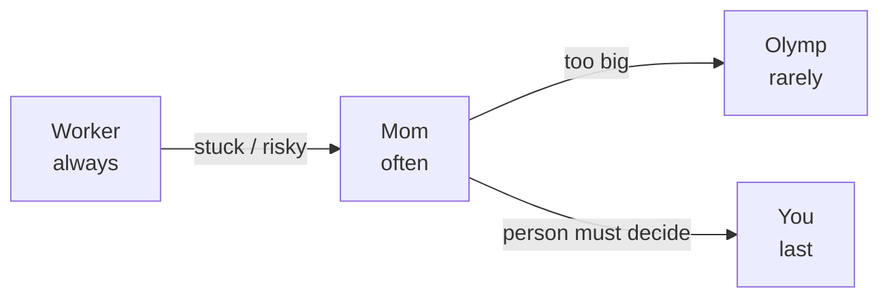

# Calling Mom

[](https://github.com/SlyBase/calling-mom/actions/workflows/ci.yml)
[](https://github.com/sponsors/slydlake)

**Your attention is the most expensive model in the stack. Calling Mom calls it last.**

Watching many agent sessions and boards costs money, time and nerves. A model cannot tell when it is out of its depth. So the worker never has to ask: the plugin watches for signals and calls a better model for it.



> *Homer, Iliad I: Achilles is stuck and calls Thetis, the sea goddess. She rises and helps. Once she climbs to Olympus for Zeus. Same here: Worker is Achilles, Mom is Thetis, Olymp is Zeus.*

## What makes it different

- **Signals, not self-assessment.** The plugin watches for four signals (same error 3×, a risky command, a "done" claim, a question) and calls Mom for the worker. The worker never has to judge itself.
- **HOLD before the command runs.** A pre-flight check reads the situation (card + command) and blocks a risky command before it executes. Optional `fail_closed`: a critical command stays held when Mom cannot check it.
- **A strong model only rarely, with hard caps.** Olymp: 1 call per card, 6 per day. On the author's board (7 days): 3,182 worker tool calls, 81 to Mom, 0 to Olymp.
- **The person last, with a four-line brief.** One tap in the Desktop or a phone reply answers the card. Decide now, or later: nothing gets lost. Your answers become precedents Mom can cite.
- **One dashboard for everything.** The Calling Mom page: ladder with 7-day counts, a Needs-you list, Active cards, and a New-card form. Badges on every Kanban card.
- **Measured.** A 20-card benchmark (10 risky, 10 harmless): the pre-flight holds 70 % of risky commands (stock: 20 %), avoids 80 % of destructive effects (stock: 30 %), and blocks 0 harmless cards.

## Quick start

```bash
hermes plugins install SlyBase/calling-mom
hermes calling-mom setup     # pick Mom and Olymp, name a board
hermes calling-mom doctor    # one real test call to each
```

## Screenshots

| The Calling Mom page | Badges on cards | A brief | A HOLD |
|---|---|---|---|
|  |  |  |  |

<!-- TODO: new screenshots for 1.7.0 — New-card form, phone brief, Decide-later section -->

## Safety

Nothing leaves your machine until you enable it and name a board. `[local-only]` on a card always wins. Secrets are blanked before any egress. No telemetry. Every data flow is in [SECURITY.md](SECURITY.md).

## More

- [Technical reference](docs/TECHNICAL.md): all signals, options, the demo kit, the HOLD benchmark, the real report, development
- [SECURITY.md](SECURITY.md) · [CHANGELOG.md](CHANGELOG.md)

MIT licensed.
