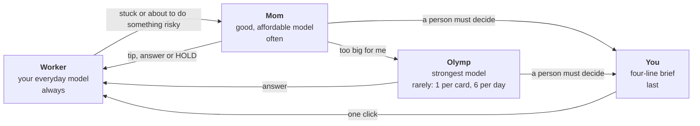
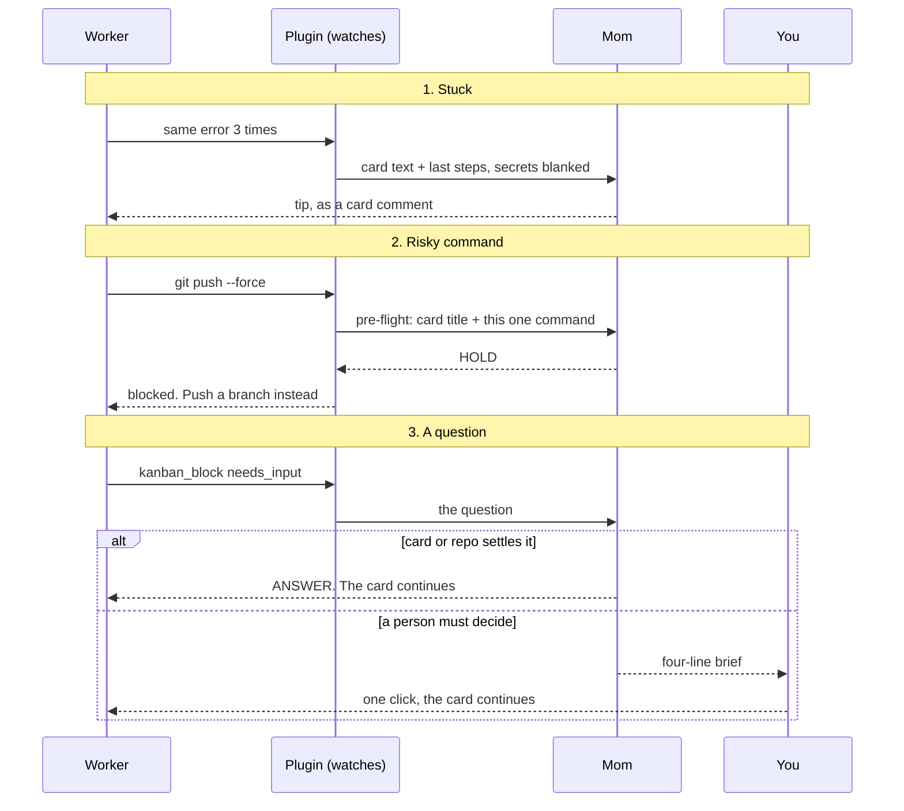
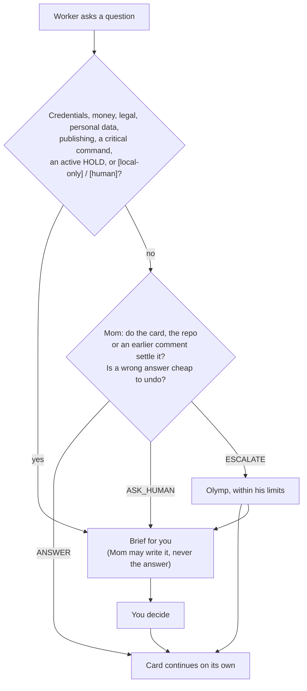

# Calling Mom

[](https://github.com/SlyBase/calling-mom/actions/workflows/ci.yml)

**Your attention is the most expensive model in the stack. Calling Mom calls it last.**

A [Hermes](https://hermes-agent.nousresearch.com) plugin for Kanban. A cheap model works your cards. When it is stuck
or about to do something risky, a better model steps in. Only what neither can settle reaches you.

## The idea in one picture



> *Homer, Iliad I: the hero Achilles is stuck and calls his mother, the sea goddess Thetis. She rises from the sea and
> helps. Only once does she climb to Olympus to ask Zeus. Same here: the worker is Achilles, **Mom** is Thetis, **Olymp** is Zeus.*

A weak model cannot tell when it is out of its depth. So the worker never has to ask. The plugin watches for **signals**
and calls Mom for it.

## What happens to one card



## Quick start (one minute)

[Install in one click](hermes://plugin/install?repo=SlyBase/calling-mom&enable=1). GitHub does not turn custom links into
links, so if it does not open, paste `hermes://plugin/install?repo=SlyBase/calling-mom&enable=1` into your browser. Or by hand:

```bash
hermes plugins install SlyBase/calling-mom
hermes plugins enable calling-mom
hermes calling-mom setup     # pick Mom and Olymp from the providers you already have; name a board
hermes calling-mom doctor    # one real test call to each, tells you what is missing
```

Then watch every rung fire. The demo has a board of its own and a scratch folder with a **local** bare git remote. It never
touches a real remote. At the `setup` prompt name the board `calling-mom-demo` and say yes to answers
(or pass `--boards calling-mom-demo --answer`). Use a worker profile you can throw away.

```bash
python ~/.hermes/plugins/calling-mom/scripts/demo.py --assignee <your-worker-profile>
```

| Demo card | What happens |
|---|---|
| Flaky build | The worker runs the same failing command three times. Mom gives a tip. The worker fixes it. |
| Greeting | The worker asks which config file to change. Mom answers. The card continues. |
| Release notes | The worker has to replace `main` on a shared remote. Mom says **HOLD** before the command runs. |
| Notes | A card with a `verify:` line. The command must pass before the card can finish. |

A model decides what happens, so a run can miss one step: the script says `NOT FIRED`. Run it again.
`--reset` removes everything the demo made.

## What you will see

In Hermes Desktop: the **Calling Mom page** (the ladder with the last 7 days, a *Needs you* list, recent activity) and
**badges on Kanban cards** (`mom`, `olymp`, `held`, `for you`, `verified`, `verify failed`).


| A Kanban board with badges | A brief with **Accept recommendation** | A HOLD that stopped a command |
|---|---|---|
|  |  |  |

## When is Mom called?

| You see | Signal | Mom does |
|---|---|---|
| Worker spins | Same error, same command or broken tool call, 3 times | Short tip: cause, next steps |
| Worker gives up | A "capability" block or a crashing card | Takes over the whole card, once |
| Worker is about to do something risky | Force push, release, `terraform apply`, `kubectl delete`, `DROP TABLE`, broad `rm -rf`, secrets, ... | **Checks before it runs.** HOLD or go |
| Worker says "done" | The result against what the card asked | Missing parts go back once |
| Worker has a question | `kanban_block` with `needs_input` (answers on) | Answers, or writes you a brief |
| You want it | `[crit]` on the card: Mom's model from the start. `[review]`: a separate reviewer. `verify: <cmd>`: the command must pass first, no model needed | as marked |

Mom writes her reply as a comment **in the card**. A slow Mom never holds the worker up: a late answer reaches it with its
next tool result, marked `[late advice]`. Every signal, one by one: [technical reference](docs/TECHNICAL.md#signals-one-by-one).

## Mom answers first

Off until you say yes (`setup` asks, or `--answer`). Then a worker question goes to Mom before it goes to you:



A brief is always four lines:

```
[for you] Question: Which auth provider do we use?
Options: A) Okta B) Auth0
Recommendation: B, it is cheaper.
If nobody answers: the card stays blocked.
```

Answer with `hermes calling-mom answer <task> --accept` (takes the recommendation), `--text "Use A"`, or `--allow-once`
(lets a held command run once). Or click in Desktop. A model error or a timeout changes nothing: the card stays blocked.

**Your answers become Mom's rules.** The plugin keeps your question and answer as redacted text (500 characters each) in
`logs/calling-mom-precedents.jsonl`. For a similar question Mom sees up to three and says so: "as decided on t_...".
Owner-only topics and `[local-only]` cards are never stored. Manage it with `hermes calling-mom precedents [forget <id> | clear]`;
turn it off with `calling_mom.answer.precedents: false`.

## When is Olymp called?

**Almost never.** Only when all three are true:

1. The case is a risky change, a `SECOND-OPINION` or a worker question. Stuck errors, loops and "done" checks never go to Olymp.
2. Mom wrote `ESCALATE: <reason>`: a high-stakes case she cannot judge as safe, with no way back.
3. The limits hold: **1 Olymp question per card and 6 per day**.

If Olymp is down or the limit is reached, the card carries on without him. Advice arrives right after the command ran:
it warns, it cannot undo. (The pre-flight HOLD is the part that stops a command *before* it runs.)

## Commands

| Command | What it does |
|---|---|
| `hermes calling-mom setup` | Choose Mom and Olymp from your own providers. Safe to repeat. Scripts: `--mom provider/model --olymp none --boards '*'`, exit code 2 when a flag is missing. |
| `hermes calling-mom status` | Who is Mom, who is Olymp, Olymp calls today, providers that are limited or down. |
| `hermes calling-mom doctor` | Checks the setup and makes a real call to each model. Run it after every Hermes update. |
| `hermes calling-mom report` | What reached whom and what it cost, per rung. `--days 7`, `--board X`, `--json`. Example: [a real report](docs/TECHNICAL.md#a-real-report). |
| `hermes calling-mom answer <task>` | Answers a card that has a `[for you]` brief or a HOLD: `--accept`, `--text "..."`, `--allow-once`. |
| `hermes calling-mom precedents` | Lists, forgets or clears the answers Mom may reuse. |
| `hermes calling-mom pace --board B --max 1 --dry-run` | Shows how at most one card at a time would be ready or running. Without `--dry-run` it writes parent links; `--undo` removes exactly those. |

**When a quota stops everything.** A worker that hits a usage limit gets one `[quota]` comment (provider, reset time, work
is kept). Mom and Olymp do not call a limited or dead provider: one `[advisor unavailable]` comment says until when.
`setup --fallback provider/model` names a second model for Mom (never for Olymp). A card `running` without a heartbeat
for `stall_minutes` (default 15) gets one `[stalled]` comment with the reclaim command. The plugin never reclaims by itself.
Models from *Advanced Delegation* can be reused: [how](docs/TECHNICAL.md#reuse-your-advanced-delegation-models).

## What a card looks like

```
[architecture/critical_change] run 68 · claude-sonnet-5-5 (claude-subscription-directsdk-experimental): 2719 in / 780 out
Biggest risk: the SSH keys now sit unencrypted in the scratch folder ... Double-check: delete them after the deploy ...
```

A HOLD stops the command **before** it runs, and that exact command stays blocked on this card until a person releases it:

```
[pre-flight] HOLD: it rewrites shared history. Instead: push a branch and open a PR.
This exact command stays blocked on this card until a human allows it.
```

A timeout, a down provider, an unparseable answer or the per-card cap lets the command run. The after-the-fact review
happens as before. When Mom settles a question: `[mom answered] Change config B. Config A is generated by the build ...`

## Desktop

Two halves, one package. The Python half (hooks, backend routes) runs where the gateway runs. The Desktop half
(`desktop/plugin.js`) runs in the app.

```bash
hermes plugins install SlyBase/calling-mom
hermes plugins enable calling-mom      # the Python half
```

Then switch the Desktop half on in **Capabilities -> Plugins**. It ships off until you say so. Badges need Desktop
0.22.6 or later. The status-bar chip reads `mom offline`? The app cannot reach the backend routes: check that the plugin
is enabled, then run `hermes gateway restart` once.

### Desktop on another machine

Does the app run on a different machine than the gateway (a Mac connected to a server, say)? Then it shows no page, no
badges and no chip, although the plugin works on the server. The app loads Desktop plugins from **its own disk** only.
On the machine that runs the app:

```bash
mkdir -p ~/.hermes/desktop-plugins/calling-mom
curl -fsSL https://raw.githubusercontent.com/SlyBase/calling-mom/v1.5.3/desktop/plugin.js -o ~/.hermes/desktop-plugins/calling-mom/plugin.js
```

Press **⌘K**, choose **Reload desktop plugins**, and switch Calling Mom on under **Capabilities -> Plugins**. Repeat the
`curl` after a plugin update.

## Your money and your data

- **Nothing leaves your machine until you say so.** Helpers are off until you enable them and name a board (or put `[advisor]` on a card).
- **`[local-only]` on a card always wins**: nothing from that card is sent anywhere.
- **What Mom sees:** the card text, the last tool steps and the signal. For a pre-flight check: the card title, the first 800 characters and the one command. For a question: the question, the card text and the last comments. **Secrets are blanked out first.** The log keeps hashes, never the command.
- **Answers are a separate switch** (`calling_mom.answer`, off by default). Questions about secrets, money, legal matters, personal data or publishing never get an answer from Mom. Only a person can release a HOLD.
- **Other people on your board are counted, not read:** author ids, event kinds and times. Never comment text.
- **Chat waits are a separate switch** (`calling_mom.count.chat_waits`, off by default): kind, seconds and outcome of a prompt, never the text.
- **Olymp is limited by number of calls**, so a subscription never surprises you. Mom has a daily dollar and token cap.
- **No telemetry.** The plugin changes your config only through `setup`, with the values you picked. `pace` writes card links only when you run it.

Every data flow is listed in [SECURITY.md](SECURITY.md).

## Minimal configuration

`setup` writes this for you. By hand, in `config.yaml`:

```yaml
calling_mom:
  mom:   {provider: openrouter, model: deepseek/deepseek-v4.1-flash-1017}
  olymp: {provider: claude-subscription-directsdk-experimental, model: claude-opus-5-5}   # leave empty for no Olymp
  advisor: {enabled: true, boards: [my-board]}
  answer: {enabled: true, boards: [my-board]}   # optional: Mom answers worker questions first
  mom_fallback: {provider: openrouter, model: deepseek/deepseek-v4.1-flash-1017}   # optional: answers while Mom's provider is limited or down
  stall_minutes: 15                             # optional: flag a running card without a heartbeat (0 = off)
```

Hermes only lets a plugin use a model you have granted (`plugins.entries.calling-mom.llm.*`); `setup` does that too.
Kill switch: set `CALLING_MOM=off`. Every other option is in the [technical reference](docs/TECHNICAL.md).

## Something wrong?

| You see | Try |
|---|---|
| `[advisor unavailable]` in a card | `hermes calling-mom doctor` names the cause (key limit, login, missing grant). |
| Nothing happens at all | `hermes calling-mom status`: is a board opted in? Is the advisor on? |
| Two sweep cron jobs | `doctor` lists them. `setup` never creates a second one. |

## More

- [Technical reference](docs/TECHNICAL.md): all options and signals, record kinds, the hook budget rule, the demo kit, metrics, how the risk list was built, what was measured, development and release
- [SECURITY.md](SECURITY.md) · [CONTRIBUTING.md](CONTRIBUTING.md) · [CHANGELOG.md](CHANGELOG.md)

The idea behind the ladder comes from DeepSeek Harness's [*Exploring Super-agent Design*](https://x.com/DeepSeekHarness/article/2116857257245987236): Calling Mom is its watchdog and two-stage filter, for Hermes Kanban.

MIT licensed.
