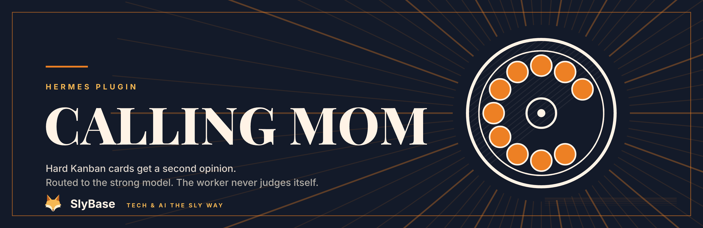

# Calling mom



A [Hermes](https://hermes-agent.nousresearch.com) plugin that lets a **cheap local model run your Kanban board** and "calls mom" (a stronger model) only where the board shows it is needed.

The local model never judges itself. A weak model does not know when it is out of its depth, so every trigger is a **durable fact from the board or the tool results**, not a self-assessment.

> Status: 1.0.0, private preview. Tested on one setup (local vLLM worker, DeepSeek via OpenRouter as the strong model).

## What it does

| Trigger | Action | Cost |
|---|---|---|
| Worker blocks a card with kind `capability` (or untyped) | Pin the card to the strong model, return it to `ready`, once. A second block parks it for a human. | one strong run |
| The crash circuit breaker parks a card (`gave_up`) | Same, via a cron sweep (the breaker emits no block hook). Infrastructure failures are skipped. | one strong run |
| `[crit]` in title/body | Pin to the strong model at claim time. | one strong run |
| Stuck signal in a worker run (same error x3, identical call x3, malformed call x3, 40+ steps) | **Advisor**: one short question to the strong model with a redacted tail of the run. The answer is appended to the tool result. The worker keeps going. | ~300 output tokens |
| Edit of a risky file / risky command (`*.tf`, `migrations/`, `terraform apply`, ...) | Same advisor call, category `architecture`. Also reachable as the `second_opinion` tool and as a `SECOND-OPINION:` comment. | ~300 tokens |
| `verify: <cmd>` line on a card | Gates `kanban_complete`: the command must pass. Failures go back to the worker. After `max_fix` failures the advisor looks at it. | free |
| `[review]` in title/body | On `kanban_complete` the plugin itself calls `kanban_request_review(reviewer=...)`. A separate reviewer profile with the strong model reads the result. | one short review run |
| `ladder.effort_first: true` (off) | First give-up raises `reasoning_effort` on the same model before paying for another one. | free |

Only the **stuck point** goes to the strong model, not the whole turn. Blocks that need a human (`needs_input`, `dependency`) are never escalated.

## Install

```bash
hermes plugins install SlyBase/calling-mom
hermes plugins enable calling-mom
```

Then set the strong model (defaults: `deepseek/deepseek-v4.1-flash-1017` on `openrouter`):

```bash
hermes config set calling_mom.model <model> --force
hermes config set calling_mom.provider <provider> --force
```

### Cron sweep (needed for breaker-parked cards and metrics)

```bash
cp ~/.hermes/plugins/calling-mom/scripts/sweep.py "$HERMES_HOME/scripts/calling_mom_sweep.py"
hermes cron create "every 1m" --name calling-mom-sweep --no-agent \
    --script calling_mom_sweep.py --interpreter <hermes venv python> --deliver local
```

### Advisor (opt-in, off by default)

The advisor sends redacted code to a remote model, so it is off until you opt in twice:

```bash
hermes config set calling_mom.advisor.enabled true --force
hermes config set calling_mom.advisor.boards '[my-board]' --force     # or put [advisor] on a card
```

The plugin calls the model through `ctx.llm`, which Hermes only allows for models you grant:

```bash
hermes config set plugins.entries.calling-mom.llm.allow_model_override true --force
hermes config set plugins.entries.calling-mom.llm.allow_provider_override true --force
hermes config set plugins.entries.calling-mom.llm.allowed_models '[<model>]' --force
hermes config set plugins.entries.calling-mom.llm.allowed_providers '[<provider>]' --force
```

### Reviewer profile (for `[review]` cards)

```bash
hermes profile create reviewer --clone-from <your-profile> --no-alias
hermes -p reviewer config set model.default <strong-model> --force
hermes -p reviewer config set model.provider <provider> --force
# remove inherited local endpoint settings: model.base_url, model.api_key, model.api_mode
hermes -p reviewer plugins disable calling-mom
```

## Configuration

All keys live under `calling_mom:` in `config.yaml`. Defaults are in `__init__.py` (`DEFAULTS`).

| Key | Default | Meaning |
|---|---|---|
| `model`, `provider` | DeepSeek Flash / openrouter | The strong model. |
| `marker` | `[crit]` | Pin the card to the strong model. |
| `local_only_marker` | `[local-only]` | Such cards never send anything to a remote model. Always wins. |
| `limits` | `same_error 3, loop 3, malformed 3, steps 40` | Stuck-signal thresholds. |
| `advisor.*` | disabled | `enabled`, `boards`, `marker`, `max_consults_per_card 3`, `max_output_tokens 700`, `context_chars 6000`, `daily_usd_cap 2.0`, `daily_token_cap 200000`. |
| `categories.<name>` | inherit | Per category (`error`, `loop`, `validation`, `architecture`) its own `model`/`provider`. |
| `verify.*` | see below | `timeout_s`, `max_fix`, `trusted_creators ["user"]`, `allow`. |
| `review.*` | `[review]` / `reviewer` | Marker and reviewer profile (`""` = off). |
| `ladder.effort_first` | `false` | Free rung before the strong model. |
| `metrics.pushgateways` | `[]` | Pushgateway URLs, tried in order. `instance` defaults to `hermes`. |

Kill switch: `CALLING_MOM=off` in the environment.

## Security model

Card text can come from mail or web content, so treat it as untrusted.

- **`verify:`** runs only for cards created by `verify.trusted_creators`, never through a shell (`shlex`), only commands whose first word is in `verify.allow`, with a reduced environment. `python3 -c` is still arbitrary code: the creator check is the real control. Ignored lines are logged as `verify_ignored`.
- **Advisor** is opt-in per board or card. Context is redacted with Hermes' `redact_for_egress`. Board tool results (`kanban_*`) are filtered out of the context. Daily USD and token caps apply.
- **Observation log** (`logs/calling-mom.jsonl`) stores hashes and counts, no content.
- The plugin never edits Hermes config.

## Metrics

`metrics.py` renders Prometheus text from the plugin log, the spend ledger and read-only board DBs. The sweep PUTs it to `/metrics/job/calling_mom/instance/<instance>` on the first reachable Pushgateway. Families: `calling_mom_events_total`, `_advisor_calls_total`, `_advisor_tokens_total`, `_advisor_cost_usd_total`, `_stuck_signals_total`, `_verify_total`, `_verify_ignored_total`, `_review_redirects_total`, `_ladder_total`, `_spend_today_{usd,tokens}`, `_spend_cap_{usd,tokens}`, `_cards{board,state}`, `_last_push_timestamp_seconds`.

The Pushgateway keeps the last push, so alert on the age of `calling_mom_last_push_timestamp_seconds`, not on absence.

## What we measured, and what we did not

24 runs (6 hidden-test coding tasks x 4 arms: local, local + high reasoning effort, local + advisor, strong model). **All 24 were correct.** The local model solved every task alone, so this set shows **no case for escalation**: it is too easy to find the capability boundary. `ladder.effort_first` stays off because high effort was slower for no gain. Build a harder set (multi-file, ambiguous spec) before tuning any threshold.

Known limits:

- The advisor was exercised live once; the stuck detectors fired one false positive (fixed: the identical-call history now resets on `write_file`/`patch`).
- `claim_review_task` fires no `kanban_task_claimed` hook, so the strong model cannot be pinned per review run. That is why review uses a separate profile.
- `model_override` is per card, not per run.
- The plugin imports Hermes internals (`hermes_cli.kanban_db`, `kanban_db_connect`, `kanban_db_boards`). `hermes plugins validate` passes but warns about them; a Hermes update can break the plugin. The tests catch that.
- The dispatcher tick hook did not fire in the gateway we tested. The cron sweep replaces it.

## Development

Needs a Hermes checkout/venv (the tests use the real `kanban_db`). No pytest required:

```bash
python -W error::ResourceWarning -m unittest test_signals test_calling_mom test_metrics
```

Tests write to a sandbox, never to your real log.

## Assets

`assets/` holds the plugin visuals: the banner, the 512 px icon (rounded tile with the SlyBase fox badge) and the fox mark itself. Form language is Hermes printmaking (engraved radials, thin frame, chiaroscuro) on the SlyBase product palette.

The SVGs are generated from one script:

```bash
python3 tools/make_assets.py       # rewrites assets/*.svg, Python 3 only
```

Rendering the PNGs needs the Inter and Playfair Display fonts (Google Fonts) and any SVG renderer, e.g. `resvg -w 3200 assets/calling-mom-banner.svg -o assets/calling-mom-banner.png`.

## License

MIT
